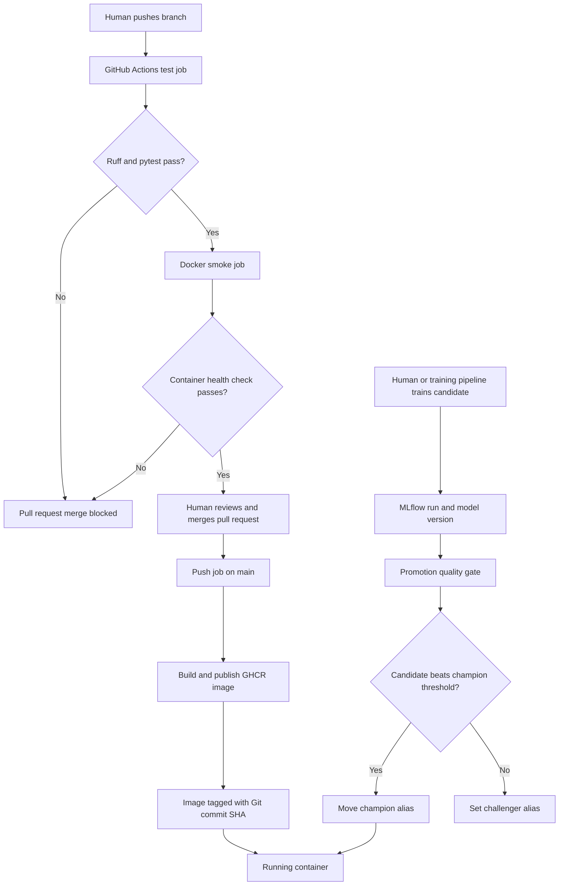

# Lab 5 — CI/CD, Data Validation, and Model Promotion

## Question 1

A unit test should not load the real model from MLflow because that introduces external dependencies. The test could fail because the MLflow server is stopped or unreachable, because the model alias or artifact is missing, or because downloading and loading the model takes too long. These failures do not necessarily mean the API code is incorrect.

## Question 2

`test_predict_returns_valid_json` proves that the API accepts an uploaded image, decodes and transforms it, calls a model, and returns a valid response containing a category and confidence value. It does not prove that the trained model is accurate, that the real MLflow model loads successfully, or that predictions generalize to new food images.

## Question 3

The content-hash duplicate check detected identical images in different dataset splits. For example, the mini dataset contained identical Bread images in the training and evaluation splits.

A cross-split duplicate causes data leakage: the model can encounter the same image during training and evaluation, making its evaluation accuracy look better than its real performance on unseen data. A corrupted image usually causes an obvious error, while leakage can silently produce misleading results.

## Question 4

The validator can run locally before data is pushed to DVC and inside the training pipeline after `dvc pull` makes the dataset available. It could also run on a self-hosted CI runner that has access to the DVC remote. The normal GitHub-hosted test runner cannot validate data that it cannot download.

## Question 5

Because `smoke` declares `needs: test`, GitHub skips the smoke job when linting or unit tests fail. This prevents spending time building a Docker image from broken code. Without `needs`, the two jobs could run in parallel, so the smoke job might run even when the test job fails.

## Question 6

The first successful workflow with the `test` and `smoke` jobs took about 2 minutes 11 seconds. The later workflow with `test`, `smoke`, and registry `push` took about 4 minutes 59 seconds. The later workflow was longer because it also built and uploaded the container image.

Dependency installation benefits from the uv cache, while Docker Buildx uses the GitHub Actions cache for image layers. Cache hits make repeated dependency installation and unchanged image layers faster, although the total duration can still increase when the workflow performs additional work such as pushing the image.

## Question 7

A commit-SHA tag identifies the exact source revision used to build an image, so deployments are reproducible and can be rolled back reliably. The `latest` tag is mutable.

For example, machine A could pull `latest` before a new image is published, while machine B pulls it afterward. Both machines would say they run `latest`, but they would actually run different code. A SHA tag prevents this ambiguity.

## Question 8

The push job explicitly requests `contents: read` and `packages: write` because it needs to read the repository and upload an image to GHCR. GitHub tokens should receive only the permissions required by the job.

A compromised step with broad write access could modify repository contents, create releases, alter workflows, publish malicious packages, or interfere with pull requests and issues.

## Question 9

The pull request displayed a failing required `test` check, skipped the dependent `smoke` job, and disabled the merge button. After fixing the test and pushing again, both required checks passed and GitHub allowed the merge.

This changes testing from a voluntary developer habit into an enforced repository rule. Team members cannot merge code into `main` until the shared CI checks pass.

## Question 10

The measurable baseline champion was version 2 with test accuracy `0.1195`. The previous version 1 could not be used as the baseline because its associated run contained no metrics.

Candidate version 3 also achieved `0.1195`. With 1,096 evaluation images, twice the champion's standard error was `0.0196`, or 1.96 percentage points. The required accuracy was therefore `0.1391`. Version 3 failed the gate and received the `challenger` alias.

Candidate version 4 achieved `0.7007`, which was well above the required `0.1391`. It passed the gate and received the `champion` alias.

## Question 11

One option is to run the promotion script on a self-hosted GitHub Actions runner on the same machine or network as MLflow. Another option is to host MLflow on a reachable service such as DagsHub and provide the workflow with the required credentials. The script could also run directly on the training machine after training finishes.

## Question 12

The code version is selected by the immutable Git commit SHA used as the container tag. The model version is selected independently by the MLflow `champion` alias. CI testing, image building, smoke testing, and image publishing are automatic. Pull-request review, merging, training initiation, and deployment are still human-controlled in this lab.

